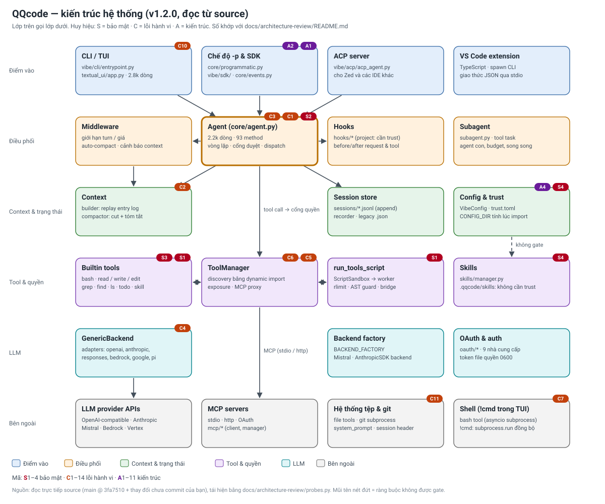

# QQcode — Rà soát kiến trúc và bug

**Ngày kiểm:** 2026-10-19
**Mốc source:** `main` @ `3fa7510`, kèm thay đổi chưa commit của bạn (`vibe/cli/textual_ui/app.tcss`, `tests/test_ui_mouse_move_over_input.py`). Không sửa code nguồn; chỉ thêm thư mục này.
**Phạm vi:** `vibe/` (199 file, 42 345 dòng), `tests/` (151 file, 29 491 dòng), `vscode-extension/` (3 054 dòng TypeScript, chỉ đọc cấu trúc).
**Cách kiểm chứng:** đọc trực tiếp các module lõi; quét AST và đồ thị import toàn bộ `vibe/`; chạy pytest, ruff, pyright; tái hiện từng lỗi bằng [`probes.py`](probes.py) (Agent thật với fake backend, không cần mạng).

---

## 1. Kết luận

**Kiến trúc hiện tại có nền tảng tốt nhưng chưa ổn để gọi là an toàn và ổn định. Cần nâng cấp có chủ đích, không cần viết lại.**

- **Nền tảng tốt:** phân tầng rõ (điểm vào → Agent → context / tool / LLM); session lưu dạng event log append-only và context được *replay* từ log; tool và message dùng Pydantic; pyright 0 lỗi; ruff sạch; 1 247 test pass.
- **Vấn đề lớn nhất là cổng quyền bash.** Quyết định duyệt dựa trên so khớp chuỗi (prefix, tách theo `&&`/`;`/`|`), nên bị bypass. Đã tái hiện: `echo $(...)` chạy không hỏi (S1); plan mode không read-only (S2); `path_denylist` không áp dụng cho `cat` qua bash (S3).
- **Lỗi hành vi quan trọng:** tool ném exception làm hỏng cả lượt (C1); compaction làm mất yêu cầu mới nhất với model có cửa sổ nhỏ (C2); cảnh báo context bị ghi vào lịch sử nên resume ra context khác (C3).
- **Tài liệu đang hứa sai:** `docs/security.md` nói plan mode chỉ chạy read-only và path restriction là "hard boundary". Hai điều này hiện không đúng.

## 2. Số liệu kiểm chứng

| Hạng mục | Kết quả |
|---|---|
| pytest | 1 247 pass · 3 fail · 10 skip. Ba test fail là `tests/autocompletion/test_file_indexer.py` (flaky khi chạy `-n auto`; chạy tuần tự 9/9 pass) |
| pyright | 0 errors, 0 warnings (phạm vi `vibe/**` và `tests/**`) |
| ruff check | sạch |
| ruff format --check | 1 file lỗi: `tests/test_ui_mouse_move_over_input.py` (file chưa commit của bạn) |
| Quy mô | `vibe/`: core 29 642 dòng (128 file), cli 9 946 (48), acp 1 389 (12), setup 865 (6), sdk 498 (4). Test: 29 491 dòng |
| File lớn nhất | `textual_ui/app.py` 2 771 dòng (121 hàm) · `agent.py` 2 228 dòng (93 hàm) · `config.py` 1 797 · `entrypoint.py` 1 067 |
| Tài liệu cũ | `docs/gap-analysis/` mô tả snapshot `be6a96c` (111 file, ~19.9k dòng). Hiện đã 199 file, 42k dòng |

## 3. Kiến trúc hiện tại



*Huy hiệu trên sơ đồ khớp với mã trong mục 4. S = bảo mật, C = lỗi hành vi, A = kiến trúc.*

### 3.1 Các lớp

1. **Điểm vào**
   - `vibe/cli/entrypoint.py`: argparse, chọn TUI Textual, chế độ `-p`, hoặc ACP.
   - `core/programmatic.py` và `vibe/sdk/`: chạy agent theo lập trình.
   - `vibe/acp/`: server ACP cho IDE (Zed, …).
   - `vscode-extension/`: TypeScript, spawn CLI, nói giao thức JSON.
2. **Điều phối**
   - `core/agent.py`: vòng lặp LLM turn → tool call → cổng duyệt → commit kết quả. Có streaming, chuyển session, compact, steering.
   - `core/middleware.py`: giới hạn turn/giá, auto-compact, cảnh báo context.
   - `core/hooks/`: hook trước/sau request và tool. Hook của project cần trust.
   - `core/subagent.py`: agent con cho tool `task`.
3. **Context và trạng thái**
   - `context/builder.py`: replay entry log thành messages (edit/omit, head marker, compaction, placeholder cho tool call thiếu response).
   - `context/compactor.py`, `cut.py`, `overflow.py`: cắt, tóm tắt, phục hồi khi tràn context.
   - `sessions/`: JSONL append-only và recorder. `interaction_logger.py` là đường `.json` legacy.
   - `config.py` (VibeConfig, pydantic-settings) và `trust.py`.
4. **Tool và quyền**
   - `tools/manager.py`: discovery bằng dynamic import, exposure/deferred, proxy MCP.
   - `tools/builtins/*`: bash, read/write/edit, grep/find/ls, todo, skill, task, tool_search, run_tools_script.
   - `script_sandbox.py` + `_script_worker.py`: worker `python -I`, rlimit, AST guard, bridge gọi tool.
   - `skills/manager.py`: skill từ `~/.qqcode/skills`, `.qqcode/skills` và `.agents/skills`.
5. **LLM**
   - `llm/backend/factory.py` (`BACKEND_FACTORY`) chọn backend: `GenericBackend` với adapter registry (openai, anthropic_messages, openai_responses, openai_codex, bedrock, google, vertex, pi), `MistralBackend`, `AnthropicSDKBackend`.
   - `oauth/*` cho 9 nhà cung cấp; `model_catalog` và `models_overlay` đọc `data/models.*`.
6. **Bên ngoài:** API LLM, MCP server (stdio / http / OAuth), hệ thống tệp và git, shell.

### 3.2 Luồng một lượt (đối chiếu với code)

`Agent.act()` → `_conversation_loop` → `middleware.run_before_turn` (có thể COMPACT hoặc INJECT) → `_perform_llm_turn` (hook before_request → backend → parse và resolve tool call) → `_handle_tool_calls` (hook → `_should_execute_tool` là cổng quyền → `_execute_calls_streaming` chạy batch song song hoặc tuần tự → `_commit_tool_results`) → flush message và recorder → `middleware.run_after_turn` → lặp nếu còn tool call hoặc có steering.

### 3.3 Đồ thị phụ thuộc (AST, import cấp module)

- **Phân tầng đa số đúng:** `core` không import `cli`, `acp` hay `setup`. `cli` và `acp` phụ thuộc `core`.
- **Phụ thuộc ngược tầng (A2):** `core/programmatic.py:335-336` import `vibe.sdk` bên trong hàm. Là import lúc chạy, không phải `TYPE_CHECKING`, nhưng vẫn đảo chiều tầng.
- **Cụm chu trình import (A1):** `vibe/core/__init__.py:6` import eager `programmatic`. Vì vậy mọi `import vibe.core.*` kéo theo agent, tools, llm, sessions, middleware… Có khoảng 15 module nằm trong một SCC.

---

## 4. Danh sách bug

**Mức độ:** *Cao* = có thể chạy lệnh không hỏi quyền, hoặc làm hỏng dữ liệu hội thoại. *Trung bình* = sai hành vi có điều kiện. *Thấp* = chất lượng và vệ sinh.
**Bằng chứng:** *E2E* = đã tái hiện bằng `probes.py`. *Code* = chỉ suy ra từ đọc code, chưa tái hiện runtime.

### 4.1 Bảo mật

| ID | Mức | Lỗi | Vị trí | Bằng chứng |
|---|---|---|---|---|
| S1 | Cao | Lệnh bash trong allowlist chạy không hỏi quyền khi chứa `$()`, backtick, xuống dòng hoặc `&`. Ngoài ra `find -exec/-delete`, `tree -o`, `echo … > file` cũng tự chạy. Script bridge dùng lại cùng logic. | `tools/builtins/bash.py:337-376` (tách chỉ theo `&& \|\| ; \|`, so khớp prefix `startswith`); `agent.py:1802-1808` (ALWAYS → EXECUTE); `script_sandbox.py:365-378` | E2E: `echo $(touch X)` → 0 lần hỏi, file được tạo. Đối chứng `touch Y` → 1 lần hỏi, bị từ chối. Bridge: code |
| S2 | Cao | Plan mode không read-only. Với bash, cổng chỉ kiểm tra NEVER. Mọi lệnh không nằm trong denylist đều chạy, allowlist không bắt buộc. | `agent.py:1778-1794`; tài liệu sai ở `docs/security.md:30-31` | E2E: `python3 -c "open(…,'w')"` tạo file, 0 lần hỏi. `touch` (có trong denylist) bị chặn |
| S3 | Cao | `path_denylist` và `path_allowlist` không áp dụng cho bash. `cat .env` qua bash là lệnh allowlist nên chạy không hỏi, dù `read_file` bị chặn cho cùng đường dẫn. | `bash.py` không override `check_path_restrictions`, nên mặc định trả None (`tools/base.py:368-379`). Tài liệu hứa "hard boundary" ở `docs/security.md:41-44` | E2E: read_file → `never`; bash → `None` và allowlist `always` |
| S4 | Trung bình–cao | Nội dung của repo chưa tin cậy vẫn vào system prompt và danh sách skill: `.qqcode/instructions.md` và `.qqcode/skills/`. | `config.py:94-104` (`resolve_config_file` không hỏi trust) → `config.py:140-144` (CONFIG_DIR, INSTRUCTIONS_FILE tính lúc import); `system_prompt.py:25-29, 488`; `skills/manager.py:84-92` (không kiểm trust). `docs/security.md:63-69` không liệt kê hai mục này | E2E: repo untrusted → instructions trả về `# INJECTED-INSTRUCTIONS`; thư mục skill của repo nằm trong search path |

### 4.2 Hành vi và dữ liệu

| ID | Mức | Lỗi | Vị trí | Bằng chứng |
|---|---|---|---|---|
| C1 | Cao | Tool ném exception không phải `ToolError` làm `act()` ném ra ngoài và hủy cả lượt. Tool call bị bỏ dở. Lượt sau chèn placeholder với nội dung "interrupted" (sai, vì đây là lỗi chứ không bị gián đoạn), rồi **chèn một tin nhắn assistant "Understood." do hệ thống tự bịa, và tin này được ghi vào session**. Kết quả của các tool đứng sau tool lỗi trong cùng batch không được commit. | `agent.py:1463-1470` (re-raise); `tools/base.py:220-232` (`invoke` không bọc lỗi); `agent.py:1914-1922` (bịa "Understood."); `agent.py:1898-1903` | E2E: `act()` raised ValueError; ngữ cảnh sau đó có `tool` placeholder và `assistant "Understood."`. Phần batch: code |
| C2 | Cao (model cửa sổ nhỏ) | Khi hội thoại nhỏ hơn `keep_recent_tokens` (20 000), `select_cut` trả về 0. `_summarize` khi đó tóm tắt **toàn bộ**, kể cả yêu cầu user mới nhất. Ngưỡng auto-compact là cửa sổ − 16 384, nên với cửa sổ dưới khoảng 36k thì ngưỡng nằm dưới 20k và điều kiện này xảy ra. Overflow recovery đi qua cùng đường này. | `context/cut.py:22-59`; `context/compactor.py:274-279`; `config.py:260-266` và `1236-1254`; `agent.py:685-703` | Probe C2 (mô phỏng đúng `_summarize`, chưa chạy LLM thật): tóm tắt 5/5 tin nhắn, yêu cầu cuối không còn nguyên văn |
| C3 | Trung bình | Cảnh báo context được gắn trực tiếp vào object message đã lưu, không phải bản sao tạm. Context sống và `_log` có cảnh báo, JSONL trên đĩa thì không. Vì vậy resume cho context khác, và cảnh báo cũ tích lũy qua các lượt. | `agent.py:614-636` (sửa `messages[-1].content`); `context/builder.py:141-150` (trả về chính `entry.message`); `middleware.py:109-145` | E2E: live `[True, True]`, `_log` `[True, True]`, JSONL `[False, False]` |
| C4 | Trung bình | Gộp tool-call delta không có `index` dùng `len(merged)` làm khóa, nên đè lên tool call có index thật. Trong probe, lệnh bash của model bị thay bằng grep. | `llm/backend/generic.py:392-405` (dòng 398). Khác với `agent.py:970-982`, nơi này raise lỗi | E2E: kết quả `['read_file', 'grep']`, bash biến mất |
| C5 | Trung bình | Mỗi lần reload agent tạo `ToolManager` mới và đăng ký listener vào MCP manager, nhưng không bao giờ hủy. Listener tích lũy, và sự kiện cùng việc refresh prompt bị lặp. | `tools/manager.py:83-85`; `agent.py:2120-2125` | E2E: 4 listener sau 1 lần khởi tạo và 3 lần reload |
| C6 | Trung bình | Builtin tool bị nạp hai lần. Dynamic discovery chạy lại mọi `.py` trong `builtins/` dưới tên module khác, nên `isinstance`, monkeypatch và cache theo class không khớp nhau. | `tools/manager.py:134-167` | E2E: `available_tools()["todo"] is Todo` → False |
| C7 | Trung bình | `!cmd` trong TUI gọi `subprocess.run(shell=True, timeout=30)` đồng bộ trong handler async. UI đứng tới 30 giây, và lệnh tương tác không được tách stdin. | `vibe/cli/textual_ui/app.py:1190-1207` | Code |
| C8 | Thấp–trung | `event_task` (`queue.get`) không được hủy trong nhánh `except BaseException`. Task mồ côi có thể lấy mất sự kiện subagent của lượt sau. | `agent.py:1157-1178` | Code |
| C9 | Thấp | Sự kiện MCP tools-changed phát giữa lượt chỉ được yield ở đầu `act()` kế tiếp, nên UI không thấy cho đến khi người dùng gửi tin mới. | `agent.py:2045-2050`, `587-588` | Code |
| C10 | Thấp | 34 chỗ `except Exception: pass/continue` (22 trong `app.py`). Module tool lỗi bị bỏ qua không có log. Các lỗi "khó tái hiện" thường bắt nguồn từ đây. | `tools/manager.py:157-158`, và các điểm trong `app.py` | grep |
| C11 | Thấp | `git` chạy đồng bộ (timeout 5 giây) trên đường tạo prompt và session. Trên POSIX, stdin không được tách. | `system_prompt.py:208-256`; `interaction_logger.py:207-230` | Code |
| C12 | Thấp | Trust store lỗi parse được coi là rỗng, và lần `set()` tiếp theo ghi đè toàn bộ file. | `trust.py:163-167`, `189-209` | Code |
| C13 | Thấp | Ba test watcher trong `tests/autocompletion/test_file_indexer.py` (creation, deletion, rename) flaky dưới `-n auto`. | Test | pytest |
| C14 | Thấp | Vệ sinh repo: `snapshot_report.html` (313 KB) đang được track ở thư mục gốc. | Repo root | git |

### 4.3 Kiến trúc

| ID | Vấn đề | Chứng cứ |
|---|---|---|
| A1 | Import eager trong `vibe/core/__init__.py:6`. Mọi import `vibe.core.*` kéo theo cả hệ thống, và có cụm chu trình khoảng 15 module. | Phân tích SCC trên import cấp module |
| A2 | `core` import ngược tầng `vibe.sdk` bằng import cục bộ trong hàm. | `core/programmatic.py:335-336` |
| A3 | God object. `Agent` (2 228 dòng, 93 hàm) làm vòng lặp, cổng duyệt, dispatch, streaming, I/O session, compact, prompt, refresh MCP và đổi model. `app.py` có 2 771 dòng, `config.py` 1 797 dòng. | Số đo |
| A4 | Hai nguồn sự thật cho cấu hình và trust: hằng số tính lúc import (`CONFIG_*`, `PROMPT_DIR`, `INSTRUCTIONS_FILE`) và `resolve_config_file_for_project()` (có trust). | `config.py:94-146` so với `config.py:1612` trở đi |
| A5 | Trùng lặp. Có hai định dạng session (json legacy và jsonl). Có hai đường MCP (manager và shim `run_sync` trong ToolManager). Có hai hàm gộp tool-call (generic và agent). Có ba nguồn model catalog (`models.generated.json`, `models.curated.toml`, overlay) cộng `DEFAULT_PROVIDERS` cứng khoảng 230 dòng. Có ít nhất bốn mô hình sự kiện. | Grep và đọc code |
| A6 | Logic cổng quyền bị nhân đôi: `Agent._should_execute_tool` (`agent.py:1746-1830`) và `ToolBridge._check_permission` (`script_sandbox.py:344-390`). Hai bản đã khác nhau ở plan mode, path và hook. | Đọc code |
| A7 | Ranh giới bảo mật của bash là heuristic trên chuỗi, không có sandbox cấp hệ điều hành. `docs/sandboxing.md` thừa nhận điều này. Sandbox của `run_tools_script` là lớp phòng thủ ở mức Python (AST và whitelist builtins), không phải boundary. | `bash.py`; `_script_worker.py:236-300` |
| A8 | Object message (Pydantic, mutable) được chia sẻ giữa entry log, cache context và request, gây aliasing. Đây là nguyên nhân của C3. | `context/builder.py:141-150`; `agent.py:631-636` |
| A9 | Không có chính sách lỗi thống nhất. `_chat` và `_chat_streaming` gói mọi lỗi thành `RuntimeError`. Tool để lộ exception thô (C1). Có 34 chỗ nuốt lỗi (C10). | `agent.py:1636-1639`, `1707-1710` |
| A10 | Đồng bộ và bất đồng bộ lẫn lộn. Subprocess đồng bộ nằm trong handler async (C7, C11). `run_sync` chạy một event loop thứ hai trong thread, và chặn loop gọi nó. | `utils.py:330-345` |
| A11 | Tài liệu lệch với code. `docs/gap-analysis/` dựa trên snapshot cũ, còn nói tool chạy tuần tự, trong khi nay đã có batch song song (`agent.py:1242-1277`). `docs/security.md` hứa quá mức (S2, S3). | So sánh tài liệu với code |

---

## 5. Đánh giá: đã ổn chưa, cần nâng cấp gì?

### 5.1 Điểm mạnh nên giữ

- **Event log append-only và ContextBuilder replay.** Đây là nền tốt cho resume, fork và edit. Không nên thay.
- **Tool có schema Pydantic** (args và result). LLM có adapter registry. Hook và MCP tách lớp rõ.
- **Chất lượng tĩnh tốt:** pyright 0 lỗi, ruff sạch. Tỷ lệ test trên source khoảng 70% theo số dòng.
- **Ý định bảo mật đã có sẵn:** trust store, audit log, path rule, worker sandbox có rlimit và tắt mạng. Vấn đề là chúng chưa được áp dụng nhất quán.

### 5.2 Điểm yếu cần nâng cấp (theo thứ tự ưu tiên)

1. **Cổng quyền và thực thi shell (P0).**
   - Thay so khớp chuỗi bằng phân tích lệnh có cấu trúc. Cách đơn giản: từ chối mọi metacharacter (`$()`, backtick, `\n`, `&`, `>`, `<`) trong lệnh allowlist. Cách tốt hơn: parse argv bằng shlex hoặc parser shell, rồi allowlist theo binary kèm kiểm tra tham số nguy hiểm (`find -exec/-delete`, `tree -o`, `awk`, `sed -i`).
   - Mặc định `ask`. Plan mode yêu cầu ALWAYS (allowlist khớp), không chỉ denylist. Path rule áp dụng cho lệnh đọc file.
   - Về lâu dài: chạy bash trong sandbox cấp hệ điều hành (bwrap, landlock hoặc container) khi ở chế độ auto-approve.
   - Gom quyết định về **một** `PermissionPolicy` dùng chung cho Agent và ToolBridge (A6).
2. **Vòng đời message và context (P1).**
   - Biến message thành snapshot bất biến.
   - Cảnh báo và inject là overlay lúc tạo request, không ghi vào log (C3, A8).
   - Một nơi duy nhất đảm bảo bất biến cặp tool_call ↔ tool_result.
   - Bỏ việc bịa tin nhắn "Understood." (C1).
3. **Chính sách lỗi (P1).** Ranh giới `invoke` bọc mọi exception thành `ToolError`. `_chat` giữ nguyên kiểu lỗi thay vì gói thành `RuntimeError`. Xóa các `except: pass` không có lý do (C1, C10, A9).
4. **Compaction (P1).** Khi `select_cut` trả 0, giữ lại ít nhất lượt user mới nhất nguyên văn. `keep_recent_tokens` nên tương đối theo cửa sổ của model (C2).
5. **Nguồn cấu hình và trust (P1).** Truyền xuống một `ConfigContext` đã resolve theo trust. Bỏ hằng số tính lúc import. Gate `instructions.md` và skill của project (S4, A4).
6. **Import và discovery (P2).** Đổi import eager trong `vibe/core/__init__.py` thành lazy (`__getattr__`). Builtin tool đăng ký tường minh, chỉ dùng dynamic discovery cho thư mục người dùng. Gỡ phụ thuộc `core → sdk` (A1, A2, C6).
7. **Tách Agent và TUI (P2).** Tách Agent thành ConversationLoop, ToolExecutor, ApprovalPolicy và SessionPersistence. TUI tách controller khỏi widget. Subprocess dùng asyncio (A3, A10, C7, C11).
8. **Hợp nhất trùng lặp (P2).** Một định dạng session (bỏ json legacy sau khi có migration). Một đường MCP. Một hàm gộp tool-call. Một nguồn model catalog. Một mô hình sự kiện (A5).

### 5.3 Kết luận

- **Không đề xuất viết lại.** Làm P0 trước, kèm test hồi quy cho S1–S4. Sau đó làm P1 (C1–C5). Refactor cấu trúc P2 để sau.
- **Nếu chỉ làm một việc:** sửa cổng quyền bash. Đây là chỗ đảm bảo an toàn đang sai, và tài liệu đang hứa điều ngược lại.

## 6. Khoảng trống về test

Test hiện có chỉ kiểm tra trường hợp cơ bản (`tests/tools/test_bash.py:77-84`). Chưa có test nào cho:

- metacharacter trong lệnh allowlist;
- plan mode ghi file;
- tool ném exception không phải `ToolError`;
- compaction khi hội thoại nhỏ;
- trust gate cho `instructions.md` và skill;
- gộp tool-call thiếu index.

Nên viết test đỏ cho từng mục trước khi sửa.

## 7. Phạm vi và giới hạn

- **Đọc đầy đủ:** `core/agent.py`, `core/middleware.py`, `core/context/builder.py`, `core/context/cut.py`, `core/tools/base.py`, `core/tools/manager.py`, `core/tools/builtins/bash.py`, `core/trust.py`, `core/sessions/recorder.py`, và phần liên quan của `compactor.py`, `script_sandbox.py`, `_script_worker.py`, `interaction_logger.py`, `llm/backend/generic.py`.
- **Quét và đọc một phần:** phần còn lại của `textual_ui/`, `acp/`, `sdk/`, `subagent.py`, `programmatic.py`, `mcp/*`, `oauth/*`, các adapter LLM (anthropic_sdk, openai_responses, bedrock, google, vertex, pi), `config.py`, `system_prompt.py`, `sessions/store.py`, `hooks/*`, `skills/*`, `setup/*`, `entrypoint.py`. Đã dùng grep mẫu lỗi, phân tích AST và đồ thị import trên toàn bộ `vibe/`.
- **Chưa kiểm chứng:** hành vi thật với provider (chỉ dùng FakeBackend); TUI chạy thật; ACP với client thật; MCP với server thật; extension VS Code (chỉ đọc cấu trúc).
- Các mục ghi "Code" trong mục 4 chưa được tái hiện runtime.

## 8. Cách tái hiện

```bash
uv run python docs/architecture-review/probes.py
```

Script dùng thư mục tạm và `QQCODE_HOME` riêng, nên không ghi vào `~/.qqcode`.
